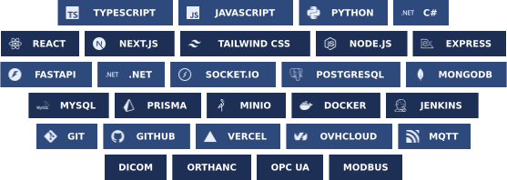

  
    
  
  
  

 

<picture>
  <source media="(prefers-color-scheme: dark) and (max-width: 600px)" srcset="https://raw.githubusercontent.com/harshaltupe12/harshaltupe12/main/assets/h-tech-dark-mobile.svg" />
  <source media="(max-width: 600px)" srcset="https://raw.githubusercontent.com/harshaltupe12/harshaltupe12/main/assets/h-tech-light-mobile.svg" />
  <source media="(prefers-color-scheme: dark)" srcset="https://raw.githubusercontent.com/harshaltupe12/harshaltupe12/main/assets/h-tech-dark.svg" />
  
</picture>

  <picture>
    <source media="(max-width: 600px)" srcset="https://raw.githubusercontent.com/harshaltupe12/harshaltupe12/main/assets/tech-mobile.svg" />
    
  </picture>

 

<picture>
  <source media="(prefers-color-scheme: dark) and (max-width: 600px)" srcset="https://raw.githubusercontent.com/harshaltupe12/harshaltupe12/main/assets/h-about-dark-mobile.svg" />
  <source media="(max-width: 600px)" srcset="https://raw.githubusercontent.com/harshaltupe12/harshaltupe12/main/assets/h-about-light-mobile.svg" />
  <source media="(prefers-color-scheme: dark)" srcset="https://raw.githubusercontent.com/harshaltupe12/harshaltupe12/main/assets/h-about-dark.svg" />
  
</picture>

<picture>
  <source media="(max-width: 600px)" srcset="https://raw.githubusercontent.com/harshaltupe12/harshaltupe12/main/assets/about-mobile.svg" />
  
</picture>

 

<picture>
  <source media="(prefers-color-scheme: dark) and (max-width: 600px)" srcset="https://raw.githubusercontent.com/harshaltupe12/harshaltupe12/main/assets/h-activity-dark-mobile.svg" />
  <source media="(max-width: 600px)" srcset="https://raw.githubusercontent.com/harshaltupe12/harshaltupe12/main/assets/h-activity-light-mobile.svg" />
  <source media="(prefers-color-scheme: dark)" srcset="https://raw.githubusercontent.com/harshaltupe12/harshaltupe12/main/assets/h-activity-dark.svg" />
  
</picture>

<a href="mailto:harshaltupe12@gmail.com">
  <picture>
    <source media="(max-width: 600px)" srcset="https://raw.githubusercontent.com/harshaltupe12/harshaltupe12/main/assets/activity-mobile.svg" />
    
  </picture>
</a>

